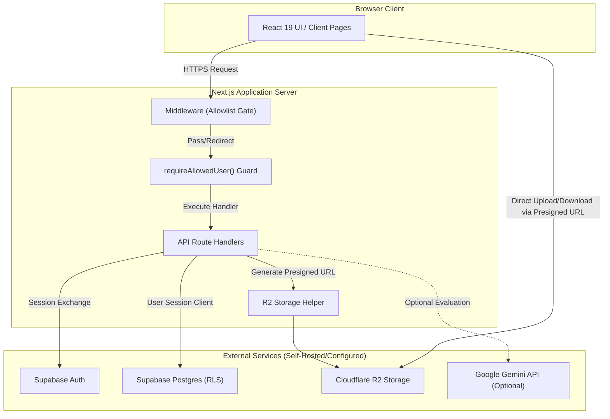

# System Architecture Documentation

This document describes the technical architecture, security boundaries, data flow, and threat model of the **UPSC Learning Platform**.

---

## 1. System Overview & Core Boundary

The platform is built as a self-hosted Next.js 15 web application. It enforces strict separation between client-side user interface components and server-side authorization boundaries.



---

## 2. Browser & Server Boundary

- **Server Components & Route Handlers (`src/app/`):** All sensitive operations, authentication verifications, database queries, and presigned URL generations execute on the server.
- **Client Components (`"use client"`):** UI interaction state, form controls, and rich charts run in the browser. Client components never receive or handle service-role credentials.

---

## 3. Authentication & Dual Allowlist Gates

The application implements a **Dual-Layer Allowlist Authorization Gate**:

```
                               ┌─────────────────────────────┐
                               │  Incoming Request to App    │
                               └──────────────┬──────────────┘
                                              │
                                              ▼
                               ┌─────────────────────────────┐
                               │ Layer 1: Middleware Check   │
                               │  (session & email allowlist)│
                               └──────────────┬──────────────┘
                                              │
                                     Passed? ├────────────► No ──► Redirect to /login
                                              │
                                             Yes
                                              ▼
                               ┌─────────────────────────────┐
                               │ Layer 2: API Server Guard   │
                               │  (requireAllowedUser check) │
                               └──────────────┬──────────────┘
                                              │
                                     Passed? ├────────────► No ──► HTTP 401 / 403 / 503
                                              │
                                             Yes
                                              ▼
                               ┌─────────────────────────────┐
                               │ Execute Route / RLS Query   │
                               └─────────────────────────────┘
```

### Why Both Gates Must Remain Synchronized
1. **Middleware Gate (`src/lib/supabase/middleware.ts`):** Fast request-level check preventing unauthenticated or unapproved users from loading HTML pages or assets.
2. **API Guard Gate (`src/lib/auth/require-allowed-user.ts`):** Defense-in-depth API guard executed inside every protected route handler. It re-verifies session authenticity and email eligibility directly on the server before database or storage execution.
3. **Database RLS Policies:** PostgreSQL Row Level Security policies enforce `is_allowed_user()` at the database level. Both application environment variables (`APP_ALLOWED_EMAILS`) and database allowlist tables must remain synchronized to ensure consistent access control.

---

## 4. User Ownership & Data Isolation Model

- **Identity Derivation:** Data mutation handlers (`POST`, `PATCH`, `DELETE`) derive `user_id` strictly from `auth.user.id` obtained via the authenticated Supabase session.
- **Payload Overrides Stripped:** Client-supplied `user_id` values in request bodies are ignored or stripped prior to database operations.
- **Data Visibility Classification:**
  - `private`: Accessible only by the record's creator (`user_id = auth.uid()`).
  - `shared_between_two`: Accessible across a designated two-user deployment when enabled by RLS policies.
  - `seed`: Read-only platform content (e.g., NCERT syllabus matrix, default PYQs).

---

## 5. Cloudflare R2 Object Storage Flow

Study materials and uploaded files are managed via Cloudflare R2 using S3-compatible presigned URLs. The server never proxies binary file content directly.

```
┌─────────┐                ┌──────────────────┐               ┌───────────────┐
│ Browser │                │  Next.js Server  │               │ Cloudflare R2 │
└────┬────┘                └────────┬─────────┘               └───────┬───────┘
     │                              │                                 │
     │  1. Request Presigned Upload │                                 │
     ├─────────────────────────────►│                                 │
     │                              │ 2. Generate Presigned URL       │
     │                              │    (expiresIn: 3600s)           │
     │  3. Return Presigned URL     │                                 │
     │◄─────────────────────────────┤                                 │
     │                              │                                 │
     │  4. Direct PUT Upload (File Binary)                            │
     ├───────────────────────────────────────────────────────────────►│
     │                              │                                 │
     │  5. Notify Complete Upload   │                                 │
     ├─────────────────────────────►│                                 │
     │                              │ 6. Verify Object & Save Metadata│
     │                              ├────────────────────────────────►│
     │  7. Return Success           │ (HeadObject check)              │
     │◄─────────────────────────────┤                                 │
```

- **Presigned URL Lifecycle:** Upload and download URLs expire automatically after 3600 seconds (1 hour).
- **Metadata vs. Storage:** File binaries are stored in Cloudflare R2 under safe UUID-based keys (`${userId}/${timestamp}-${random}.${ext}`). File metadata (title, size, mime-type, user ownership) is stored in the Supabase PostgreSQL database.

---

## 6. Planner & Study Data Domains

The data layer supports core study management sub-systems:
- **Planner Domain:** Study plans (`study_plans`), daily tasks (`daily_tasks`), weekly targets (`weekly_targets`), and study goals (`study_goals`).
- **Material Vault:** Material catalog (`material_library`), user notes (`user_notes`), and reading progress (`material_reading_progress`).
- **PYQ & Test Tracking:** Prelims & Mains question banks (`pyq_questions`), question attempts (`pyq_attempts`), and test sessions (`test_sessions`).
- **Current Affairs:** Articles and summaries (`current_affairs_entries`), classified by GS Paper (GS1-GS4) and revision schedule.

---

## 7. AI Evaluation Boundary

- Answer evaluation features utilize the Google Gemini API (`@google/generative-ai`).
- **Isolation:** AI processing is completely optional. If `GEMINI_API_KEY` is not provided, AI features degrade gracefully without breaking application features.
- **Privacy:** Answers are submitted to Gemini only when explicitly triggered by the user.

---

## 8. Threat Model & Security Controls

| Threat | Impact | Mitigation / Control |
| :--- | :--- | :--- |
| **Unauthorized Access** | Data exposure | Email allowlist gate (`requireAllowedUser()`) & Supabase Auth magic links. |
| **Insecure Direct Object Reference (IDOR)** | Cross-user data modification | `user_id` derived server-side from session; RLS policies enforce `auth.uid() = user_id`. |
| **Service Role Escalation** | Full database bypass | Service-role key (`SUPABASE_SERVICE_ROLE_KEY`) is prohibited in all application routes. |
| **Storage Traversal / Arbitrary File Overwrite** | Malicious file storage | Object keys generated server-side with random tokens; presigned URLs restricted by content-type. |
| **Open Redirects** | Phishing vector | Middleware redirect routes validate destination against application origin. |

---

## 9. Known Limitations & Extension Points

- **Deployment Boundary:** Designed for single-tenant or controlled two-user deployment models. Multi-tenant SaaS billing or automated workspace provisioning is not included.
- **Extension Points:** Contributors can extend custom topic progress analytics, add custom RSS feed ingestion parsers (`src/lib/ingestion/`), or expand subject-specific incubator lists (`src/app/optional/`).
